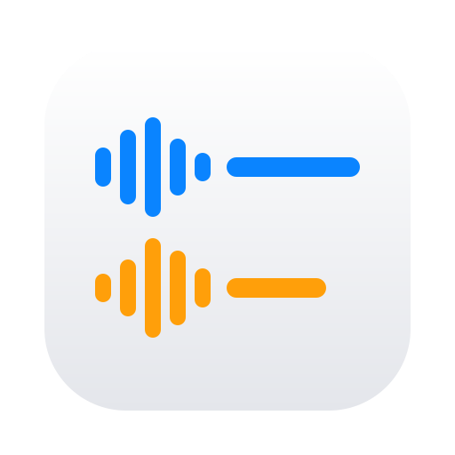
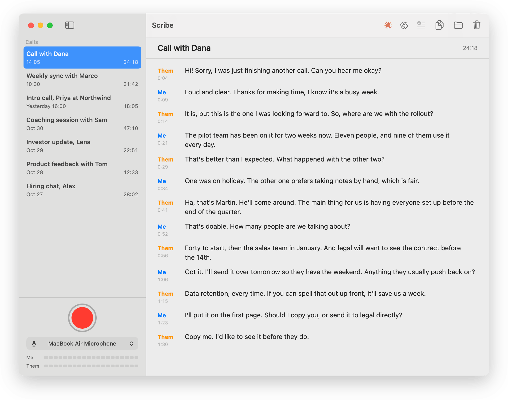

# Scribe

**[Download Scribe for Mac](https://github.com/finereli/scribe/releases/latest/download/Scribe.dmg)** (free, 1 MB download, macOS 14.2+, signed and notarized by Apple; [all releases](https://github.com/finereli/scribe/releases)) · [scribe.finereli.com](https://scribe.finereli.com)

A tiny Mac tool to transcribe your calls and paste them into Claude or ChatGPT. It listens to your Zoom, Meet, Teams or WhatsApp call from your side, so no bot joins, writes down who said what, and hands the transcript to your AI with one click. Free and open source. You bring your own OpenAI key, and an hour-long call costs about 30 cents in transcription.

<picture>
  <source media="(prefers-color-scheme: dark)" srcset="screenshots/app-dark.png">
  
</picture>

## Why I made this

A while ago I was on an important sales call. A few minutes in I realized we were on *their* Google Meet, not mine, which meant my note-taking bot was sitting in the waiting room. To get a transcript I'd have had to ask the buyer, in the middle of a pitch, to please let my robot in. I didn't. It felt like asking someone to let you record them while you're trying to get them to trust you.

So I had no transcript. Afterwards I tried to reconstruct what they'd told me, and I'd missed things that turned out to matter. I closed the deal, but barely.

That happened a few more times. I tried other tools. They were either bots, which have the same problem, or they ran big speech models that made my laptop work hard for an hour after every call. So I built the thing I actually wanted.

The first version used the speech recognizer built into macOS. It worked, but it missed a lot, especially in Hebrew, and it only did one language per call. Version 2 sends each stretch of speech to OpenAI instead. On the same calls it catches about twice as many words, it follows you when you switch languages mid-sentence, and your Mac does nothing but record. The price is that your speech goes to OpenAI, using your own key. For me that was an easy trade. If it isn't for you, [version 1.2.2](https://github.com/finereli/scribe/releases/tag/v1.2.2) is still there and keeps everything on your Mac.

## Who it's for

People who spend their days on calls and don't like taking notes: founders, salespeople, coaches, managers. If you've ever finished a call and thought "wait, what was the number they said?", this is for you.

## What's different

**It's tiny.** Scribe isn't another place your meetings live. There's no Scribe account, no workspace and no AI of its own to learn. It's a small app with no dependencies and no model to download. Pick it up when a call starts, put it down when it ends.

**Your AI does the thinking.** Click the Claude or ChatGPT button and the transcript is copied with a line of context and the app opens. Paste, then ask what you actually want to know, in your own words.

**A backup for the calls that matter.** Keep using Fathom or Granola if you like them. Scribe sits next to them for the calls where the bot is stuck in the waiting room, the meeting is on someone else's account, or the call is too important to trust to one tool.

**There's no bot.** Nobody gets a "Notetaker wants to join" message. It doesn't matter whose meeting it is or which app it's in. Scribe listens on your Mac, the same way you do.

**No middleman.** Both sides of the call are saved as audio files on your disk, next to the transcript. To transcribe, Scribe sends each stretch of speech straight from your Mac to OpenAI, using your key. Scribe has no server of its own, so there's nobody in between, and nothing to sign up for except OpenAI.

**Any language, even mixed.** There's no language to pick. OpenAI works out what's being said turn by turn, so a call that drifts from Hebrew to English and back comes out right.

**It knows who said what.** Your microphone is "Me" and whatever comes out of your Mac is "Them". For the usual one-on-one call, that's all the speaker detection you need, and it doesn't have to guess. If several people are on the other side, they're all Them.

**It's free and open source.** MIT licensed, small enough to read before you trust it with your audio, and easy to change if you want it to do something it doesn't. You pay OpenAI for transcription directly, about 30 cents an hour, and nobody else.

## Why now

Speech models got good and cheap at the same time. A year ago a transcript this good meant a subscription or an hour of your laptop's fans. Now it's a few cents a call, and it lands a second after someone stops talking.

And an AI reading the transcript doesn't need every word to be perfect anyway. It needs the conversation, and it needs it without you having to ask anyone's permission.

The bots, meanwhile, are being shown the door. In August 2026 Microsoft gave Teams admins a policy to detect and block notetaker bots. A tool that never joins the meeting doesn't have that problem.

## Next to what you already use

Scribe isn't trying to replace these. I pay for Fathom and MacWhisper, and both are good at what they do. I tried Granola too. Scribe is the small thing that works when they can't.

| | Scribe | Fathom | Granola | MacWhisper |
|---|---|---|---|---|
| How it hears the call | On your Mac | A bot joins the call | On your Mac | On your Mac |
| Works on someone else's meeting without asking | Yes | Only if they let the bot in | Yes | Yes |
| Where your audio goes | Recordings stay on your Mac; speech goes to OpenAI on your key | Their servers | Transcribed in their cloud | Stays on your Mac |
| Transcription engine | OpenAI, your own key | Cloud | Cloud | Whisper models you download |
| Load on your Mac | Recording only | None | Light | Heavy, especially with the better models |
| Account needed | Just an OpenAI API key | Yes | Yes | No |
| Summaries and analysis | Paste into your own AI | Built in | Built in | Some built in |
| Your old transcripts | Files on your disk, forever | In their app | Free plan: last 30 days | Files on your disk |
| Price | Free; about 30¢ per call-hour to OpenAI | Free tier, paid plans | Free tier, paid from $14/month | Free version, paid Pro |

Fathom is great when you own the meeting and everyone expects a notetaker. Granola is great if you want AI-written notes and don't mind the cloud. MacWhisper is great when audio must never leave your Mac. Scribe is for when you just want a good transcript of your own calls, without a subscription and without making it anyone else's business.

## Install

1. [Download Scribe](https://github.com/finereli/scribe/releases/latest/download/Scribe.dmg) and drag it to Applications.
2. Open it. macOS will ask for two permissions: **Microphone** (your side) and **System Audio Recording** (their side). Allow both.
3. Click **Add Key…** in the banner (or open Scribe ▸ Settings) and paste an OpenAI API key. You can make one at [platform.openai.com/api-keys](https://platform.openai.com/api-keys). A few dollars of credit lasts a lot of calls.

Requires macOS 14.2 (Sonoma) or later. Built for both Apple Silicon and Intel Macs.

## Use

1. Press the red button (or ⌘R) when the call starts. Check that the **Me** and **Them** meters move.
2. Talk. Each turn appears a second or two after the person pauses.
3. Press stop, then click the Claude or ChatGPT button and paste.

Every call is kept in its own folder (the folder icon opens it) with both sides recorded separately. If a call was recorded without a working key or while you were offline, or it's from before version 2, the **Transcribe** button runs it through OpenAI again.

## Made for real calls

- **Works with any calling app.** Scribe records your microphone and whatever your Mac plays, so Zoom, Google Meet, Microsoft Teams, WhatsApp desktop, FaceTime and Slack all work, in the app or the browser.
- **Nothing lost if something goes wrong.** Each turn is saved the moment it's transcribed, and both audio tracks are written to disk as the call goes. If the key stops working, the account runs out of credit or the Wi-Fi drops, Scribe keeps recording, tells you what's wrong, and catches up or lets you transcribe the call afterwards.
- **Works with any headphones.** AirPods, Bluetooth buds or wired. Scribe records whatever your Mac is using.
- **Talking over each other is fine.** Each side is recorded as its own stream, so when a laggy connection has you both talking at once, every word from both of you still makes it into the transcript.

## Build from source

Scribe is a small SwiftPM app with no dependencies.

```sh
./build.sh          # local build
open Scribe.app
```

The download on the releases page is already signed and notarized. To build your own, `SIGN=1 ./build.sh` signs it with a Developer ID, and `NOTARIZE=1 ./build.sh` also notarizes it.

## License

MIT
